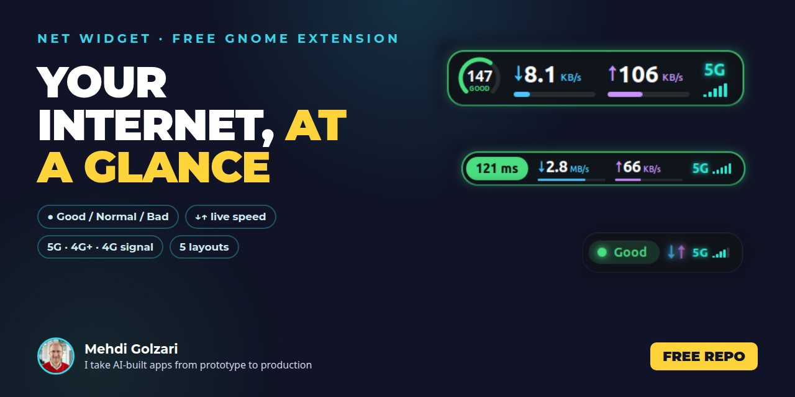
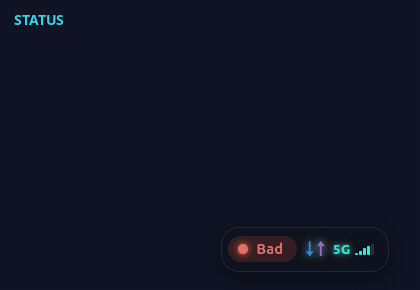
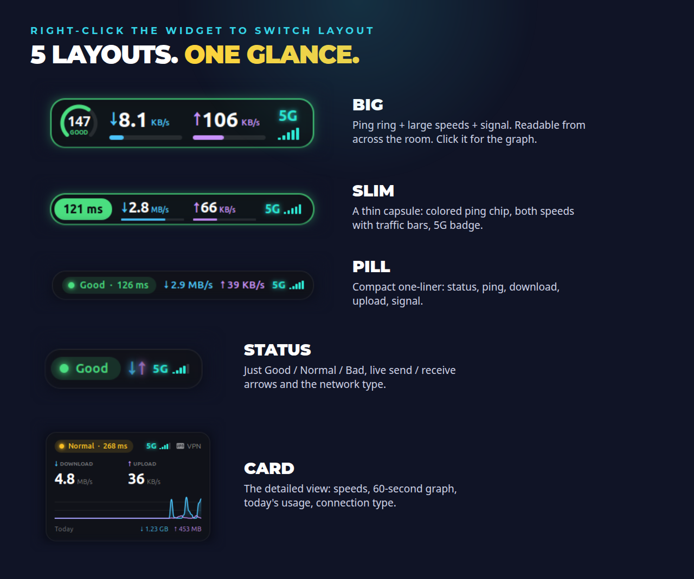
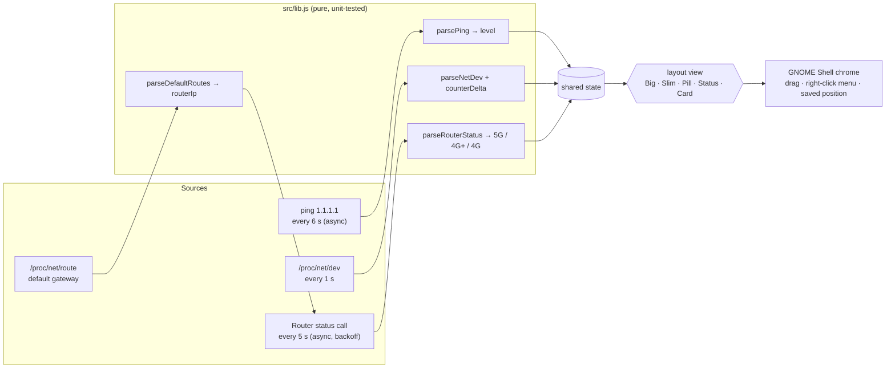

<div align="center">



# Net Widget

**Is my internet OK? Know at a glance, from across the room.**<br>
A small always-on-top GNOME Shell widget for the corner of your screen: Good / Normal / Bad status from a live ping, download and upload speed, today's usage, send/receive activity lights and, on 4G/5G routers, the network type (5G / 4G+ / 4G) with signal bars.

[](https://github.com/mgmehdiforme/gnome-net-widget/actions/workflows/ci.yml)
[](LICENSE)
[](#-install)
[](#-install)
[](#-whats-inside)
[](#-contributing)

[Install](#-install) · [Layouts](#-5-layouts) · [How the status works](#-how-good--normal--bad-is-decided) · [5G / 4G signal](#-5g--4g-signal-from-your-router) · [Architecture](#-architecture) · [FAQ](#-faq)

</div>

---

<div align="center">

<br><sub>Real capture, not a mock-up: the widget on GNOME 50 (Wayland) while a download and an upload run.</sub>
</div>

## 🔥 Why this exists

On a mobile 4G/5G router, "the internet is slow" can mean three different things: the line is fine and something is downloading, the latency went up, or the router dropped from 5G to 4G. The only way to tell was a terminal (`ping`), a system monitor, and the router's admin page in a browser.

I wanted one thing in the corner of my screen that answers *"is my internet OK?"* in under a second, **readable from my chair across the room**, so I built it. It's the kind of small tool I build with Claude Code and then take to production quality: tests, CI, a clean release, no leftovers.

What it shows, live:

- **Status**: 🟢 Good · 🟡 Normal · 🔴 Bad · Offline, graded from latency, jitter and packet loss.
- **Speed**: download ↓ and upload ↑ every second, with traffic bars that grow with the load.
- **Activity lights** (Status layout): ↓ blinks blue when you receive, ↑ blinks violet when you send, like a modem.
- **Network type and signal**: **5G** / **4G+** / **4G** / 3G with 0–5 bars, read from your router. ([which routers](#-5g--4g-signal-from-your-router))
- **Today's usage**: total downloaded and uploaded, reset at midnight, kept across restarts.

## ⚡ Install

Needs GNOME Shell 49 or 50 and the standard `ping` command (installed on every mainstream distro). Nothing else.

```bash
git clone https://github.com/mgmehdiforme/gnome-net-widget
cd gnome-net-widget
bash install.sh
```

Then **log out and back in once**: GNOME on Wayland only loads new (and updated) extensions at login. The widget appears in the bottom-right corner, above your windows; it hides when a window goes fullscreen.

- **Move it**: drag it with the left mouse button. It remembers the spot (anchored to the nearest screen corner, per monitor).
- **Change the layout**: right-click it.
- **Big layout**: left-click it to open the details panel (60-second graph, connection type, loss, today's usage).
- **Uninstall**: `bash uninstall.sh`.

Prefer a zip? Each [release](https://github.com/mgmehdiforme/gnome-net-widget/releases) has `net-widget@mgmehdiforme.github.io.shell-extension.zip`: `gnome-extensions install <zip>`, then log out and in.

## 🎛 5 layouts



| Layout | Best for |
|---|---|
| **Big** | A glance from across the room. The border glows green, amber or red, so you read the status without reading any text. |
| **Slim** | The same, half the height. A solid colored chip with the ping. |
| **Pill** | A compact one-liner next to the dock. |
| **Status** | Only *Good / Normal / Bad*, the activity arrows and the network type. No numbers. |
| **Card** | The details: both speeds, a 60-second graph, today's usage, connection type. |

The widget stays above your windows (like a sticky note) and hides itself when a window goes fullscreen.

## 🚦 How Good / Normal / Bad is decided

Every 6 seconds the widget sends 8 quick pings to `1.1.1.1` and grades the result (thresholds live in [`src/lib.js`](src/lib.js), covered by tests). *Jitter* is ping's `mdev` (the standard deviation of the round-trip time).

| Status | Rule |
|---|---|
| 🟢 **Good** | no packet lost, average latency under 150 ms, jitter under 40 ms |
| 🟡 **Normal** | 1 of 8 packets lost, or latency 150–300 ms, or jitter 40–100 ms |
| 🔴 **Bad** | 2+ of 8 packets lost (25 %+), or latency ≥ 300 ms, or jitter ≥ 100 ms |
| 🔴 **Offline** | no reply at all |

Speed and usage come from the kernel's own counters (`/proc/net/dev`). Only interfaces backed by real hardware are counted (`/sys/class/net/<if>/device`), so VPN tunnels, PPPoE, bridges, bonds, VLANs and Docker never count the same bytes twice. Usage includes traffic inside your LAN (e.g. copying to a NAS), not only internet traffic.

## 📶 5G / 4G signal from your router

My router, a **ZLT X21** 5G CPE, answers a read-only status call on the LAN: the same one its admin page uses for its top bar. Other routers that ship the same ZLT/Tozed-style web UI are likely to answer it too (tested so far: ZLT X21):

```
POST http://<router>/cgi-bin/http.cgi   {"cmd":113,"method":"GET"}
→ {"network_type_str":"5G(NSA)","signal_lvl":"4","sim_status":"1", ...}
```

Net Widget finds your router (the gateway of your LAN default route, ignoring VPN routes), asks every 5 seconds and shows:

| Router says | Badge |
|---|---|
| `5G(NSA)`, `5G SA`, `NR` | **5G** (teal) |
| `4G+`, `LTE-A` | **4G+** (blue) |
| `4G`, `LTE` | **4G** (amber) |
| `WCDMA`, `HSPA`, … | **3G** (orange) |
| SIM not ready / no service | **NO SIG** (red) |

No login and no password are needed, and nothing is changed on the router. **If your router doesn't answer this call, the badge simply stays hidden**, and the widget only retries every 5 minutes, so it is quiet on every other network.

Have a different router with a similar status endpoint? Open an issue with its JSON reply (remove any personal data first). Adding a parser is a few lines in [`src/lib.js`](src/lib.js).

## 🧭 Architecture



- **`src/lib.js`**: every parser and rule (ping grading, `/proc` parsing, gateway decoding, router reply, formatting). No GNOME imports, so it runs under plain Node in CI.
- **`src/widget.js`**: the data loop (GLib timers, `Gio.Subprocess` for ping, libsoup 3 for the router) and the five St/Clutter views. One shared state object; a view only renders it.
- **`src/extension.js`**: `enable()` creates the widget, `disable()` destroys it.

## ✅ What makes it production-ready

- **Never blocks the shell**: ping and the router call are async and cancellable; the main loop only does tiny `/proc` reads and writes one small state file (every 60 s and when you move or switch the widget).
- **Cleans up completely** on disable, lock screen and layout switches: timers and idle callbacks removed, the ping process stopped, requests cancelled, actors and menus destroyed. If start-up fails halfway, it cleans up what it created.
- **Correct numbers**: VPN/virtual interfaces excluded, counter resets and new interfaces handled, daily usage rolls over at midnight and survives restarts.
- **Polite and contained on the network**: one small LAN request every 5 s only while a supported router answers, otherwise a retry every 5 minutes; redirects are never followed and oversized replies are ignored.
- **Tested**: 14 tests in [`tests/lib.test.mjs`](tests/lib.test.mjs) cover ping grading, interface filtering, counter resets, gateway decoding and router replies, using real `/proc` and router output formats.
- **CI**: syntax check of every module (extension, dev loader, tests), unit tests, `metadata.json` validation and a packed extension zip on every push; tagged versions attach the zip to a GitHub release.
- **State in one file**: `~/.local/share/gnome-net-widget/state.json` (layout, position, today's usage). Delete it to reset.

## 🔒 Privacy

The widget talks to exactly two places: `1.1.1.1` (ping) and, if present, your own router on the LAN. No analytics, no accounts, nothing sent anywhere else.

## 🧩 What's inside

```
gnome-net-widget/
├── src/
│   ├── extension.js      enable / disable
│   ├── widget.js         data loop + the 5 layouts
│   ├── lib.js            pure parsers and rules (unit-tested)
│   └── metadata.json     uuid net-widget@mgmehdiforme.github.io, GNOME 49–50
├── tests/lib.test.mjs    node --test, no dependencies
├── install.sh · uninstall.sh
├── scripts/pack.sh       builds the installable zip
├── dev/                  hot-reload loader for development (see below)
└── .github/workflows/    ci.yml (every push) · release.yml (tags)
```

## 🛠 Developing (hot reload on Wayland)

GNOME Shell caches ES modules, so on Wayland every code change normally means logging out. `dev/` has a small loader extension that imports `widget-<N>.js` (and a matching `lib-<N>.js`) and swaps it live when a newer file appears, plus a screenshot hook so you (or your AI coding agent) can check the result without touching the mouse:

```bash
bash dev/deploy.sh --install   # once, then log out and back in
bash dev/deploy.sh             # after every change: reloads in about a second
touch ~/.cache/hot-reload/snap-request   # saves ~/.cache/hot-reload/snap.png of the corner
journalctl --user -f -o cat | grep -i hot-reload   # errors
```

Run the tests with `npm test` (Node 20+).

## ❓ FAQ

**Does it work on X11?** It targets GNOME 49 and 50, which run on Wayland by default. It doesn't use anything Wayland-specific, but it is only tested on Wayland.

**Why does the ping show my VPN's latency?** The ping goes the way your traffic goes. If your default route is a VPN, the widget grades the connection you actually use. The connection label in the Big and Card layouts says "VPN".

**Why is it above my windows?** So it is always visible, like a sticky note in the corner. Drag it somewhere it doesn't cover anything, or pick the small Status layout. It hides automatically when a window is fullscreen.

**Can I change the ping target or the thresholds?** Yes: `PING_HOST` in `src/widget.js` and the rules in `parsePing()` in `src/lib.js`. A settings page is on the roadmap.

**The 5G badge doesn't appear.** Your router doesn't answer the status call described above, or you're on another network. Everything else still works.

**Will it show up on extensions.gnome.org?** That's the plan after the first round of feedback.

## 🤝 Contributing

Issues and PRs are welcome: new router parsers, layouts, translations, a preferences page. Please run `npm test` before opening a PR.

## 🎬 Video

<!-- VIDEO -->Video walkthrough: coming soon on [YouTube @MehdiGolzari-AI-Dev](https://www.youtube.com/@MehdiGolzari-AI-Dev).

---

**Built by Mehdi Golzari.** I take AI-built apps from prototype to production.<br>
Built something with Claude Code, Cursor or Lovable that needs to be production-ready? → [I can fix, secure and launch it](https://www.fiverr.com/mehdigolzari/fix-secure-and-launch-your-ai-built-app-from-claude-code-cursor-or-lovable)

MIT © 2026 Mehdi Golzari
